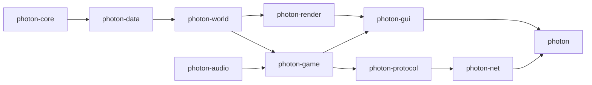

<div align="center">


# Photon

**A from-scratch Minecraft: Java Edition client in Rust: the same game, on a faster engine.**

[](https://github.com/PhotonMC/photon-client/actions/workflows/ci.yml)

-3c8527)


[](#license)

[Progress](#progress) · [Priorities](#priorities) · [Build and run](#build-and-run) · [How parity works](#how-parity-works) · [Docs](docs/README.md)

</div>

---

Photon reimplements the Java client's behaviour exactly: packets, physics, timing, camera, animation, UI and sound. Every behaviour is proven against the real Java client by a headless oracle, never by eye. Internally it is a new engine: Vulkan rendering, multi-threaded meshing and a Rust codebase with a strict quality gate.

Photon is one client. Out of the box it behaves as the Java client does; planned extras (mods, joining servers of other versions, social features) are opt-in and change nothing when off ([ADR 0010](docs/adr/0010-one-product.md)).

> Photon is **not affiliated with, endorsed by, or connected to Mojang or Microsoft**. "Minecraft" is a trademark of Mojang Synergies AB.

## At a glance

| | |
| --- | --- |
| **Reference** | Java Edition 26.2, protocol 776 |
| **Parity cases** | 4,600+ scenarios compared against the Java client before every push (pre-push hook) |
| **Code** | ~395k lines of Rust in 12 crates |
| **Started** | 2026-09-07 |

## What works today

- **Connection.** Handshake, login, configuration and play; the configuration phase entered again, transfers and cookies; online-mode encryption and session join; the title screen, server list with pings and icons, and the disconnected screen.
- **World.** Paletted chunks, a client light engine, smooth lighting and ambient occlusion, sky, clouds, fog, weather, fluids, translucent sorting, animated textures and mipmaps, meshed on worker threads with occlusion culling.
- **Movement.** The whole local player tick, compared tick by tick: collision, step-up, fluids, slime, honey, ladders, powder snow, flight, elytra and rockets, riding, sleeping and pistons.
- **Entities.** Models, animations and layers for the entity types, armor, name tags with teams and scores, glow outlines, fire, shadows and invisible states.
- **Blocks and effects.** Block entities (chests, signs, banners, beacons, portals, spawners, statues and more), block and level events, particles and their ambient effects.
- **Items.** Item models with their per-stack properties, enchantment glint, and use predictions (food, bow, crossbow, spyglass and more).
- **Screens.** HUD, chat, every container and inventory with click prediction, recipe book, advancements, statistics, the F3 debug overlay, options screens, toasts, tutorial, dialogs, and the command, structure and jigsaw block screens.
- **Sound.** Positioned sound, music, subtitles, block, entity and UI sounds.

Not there yet: Microsoft account sign-in inside the client, server resource packs, the screens shown while a server moves the player to another, local placement of many block types, fallback fonts (unifont, bidi, IME), other protocol versions, mods and packaged releases. Each one has an issue.

## Progress

<!-- progress:start -->
| Measure | Now |
| --- | --- |
| Clientbound play packets handled | 121 / 141 |
| Serverbound play packets sent | 58 / 69 |
| Screens named by the client | 53 / 98 |
| Entity types with a renderer, named by the client | 141 / 156 |
| Block entity types with a renderer, named by the client | 24 / 26 |
| Particle types named by the client | 120 / 125 |
| Parity cases | 4,776 in 17 families |
| Lint baseline entries | 970 (at introduction: 1,234) |
<!-- progress:end -->

Status per milestone, with its issue counts on GitHub. Features finished before the move to GitHub issues (2026-10-10) are summarised in [history](docs/history.md).

### Game

| Milestone | Status | Open / closed |
| --- | --- | --- |
| Foundation: connection, world, movement, rendering, block actions, items, inventories | ✅ Done | — |
| M3.d Containers opened by the server | ✅ Done | — |
| [M4 Entities](https://github.com/PhotonMC/photon-client/milestone/8) | 🟢 Done; coverage audit open | 1 / 0 |
| [M5 Text and chat](https://github.com/PhotonMC/photon-client/milestone/9) | 🟡 Fallback fonts, bidi, IME open | 1 / 1 |
| [M6 Screens and settings](https://github.com/PhotonMC/photon-client/milestone/10) | 🟢 Mostly done; start flow and option screens open | 2 / 5 |
| [M7 Sound](https://github.com/PhotonMC/photon-client/milestone/11) | 🟢 Mostly done; event sounds and screen music open | 1 / 1 |
| [M8 Particles, effects and block entities](https://github.com/PhotonMC/photon-client/milestone/12) | ✅ Done | 0 / 6 |
| [M9 Server compatibility](https://github.com/PhotonMC/photon-client/milestone/13) | 🟡 Resource packs and server switching open | 2 / 3 |
| [Gameplay debts](https://github.com/PhotonMC/photon-client/milestone/15) | 🟡 Placement, lighting, movement leftovers | 6 / 1 |
| [M10 Parity closure and distribution](https://github.com/PhotonMC/photon-client/milestone/14) | ⚪ Not started | 4 / 0 |

### Infrastructure

| Track | Status | Open / closed | Decision |
| --- | --- | --- | --- |
| [Repository and quality](https://github.com/PhotonMC/photon-client/milestone/1) | 🟢 Gate done; lint baseline burn-down open | 2 / 4 | [Coding standards](docs/development/coding-standards.md) |
| [Parity v2](https://github.com/PhotonMC/photon-client/milestone/2) | 🟢 Rust runner, cache, affected-only and parallel runs done | 3 / 5 | [ADR 0005](docs/adr/0005-parity-v2.md) |
| [ECS and threading](https://github.com/PhotonMC/photon-client/milestone/4) | 🟡 `bevy_ecs` in; entity and packet split open | 4 / 1 | [ADR 0003](docs/adr/0003-bevy-ecs.md) |
| [Versions](https://github.com/PhotonMC/photon-client/milestone/3) | 🟡 Typed packets and ids in progress | 4 / 0 | [ADR 0004](docs/adr/0004-version-support.md) |
| [Launcher and accounts](https://github.com/PhotonMC/photon-client/milestone/7) | 🟡 Encryption and session join done; sign-in open | 4 / 1 | [ADR 0007](docs/adr/0007-assets-and-accounts.md) |
| [Rendering performance](https://github.com/PhotonMC/photon-client/milestone/5) | ⚪ Planned | 3 / 0 | [Rendering](docs/architecture/rendering.md) |
| [Mod platform](https://github.com/PhotonMC/photon-client/milestone/6) | ⚪ Planned | 3 / 0 | [ADR 0006](docs/adr/0006-mod-platform.md) |

✅ done · 🟢 mostly done · 🟡 in progress · ⚪ planned

## Priorities

Work is picked by priority label, not by size:

- **[P0](https://github.com/PhotonMC/photon-client/issues?q=is%3Aissue+is%3Aopen+label%3AP0): playable on real servers.** Start flow and reconfiguring screens, server switching through proxies, block placement, Microsoft sign-in.
- **[P1](https://github.com/PhotonMC/photon-client/issues?q=is%3Aissue+is%3Aopen+label%3AP1): visible bugs, and the infrastructure every new feature is written against.** Typed packets and a packet listener, entities as ECS components, typed ids, parity in CI, the portable oracle, server resource packs.
- **[P2](https://github.com/PhotonMC/photon-client/issues?q=is%3Aissue+is%3Aopen+label%3AP2): parity leftovers and feature completion.**
- **[P3](https://github.com/PhotonMC/photon-client/issues?q=is%3Aissue+is%3Aopen+label%3AP3): additive work, deferred.** Rendering performance (about 500 fps today in a typical scene on an RX 9060 XT at 1280x720), the mod platform, the launcher, other versions, packaging.

## Build and run

You need:

- Rust (pinned in `rust-toolchain.toml`), CMake and a C/C++ compiler;
- a Vulkan driver (MoltenVK on macOS);
- Java 25 for the reference tooling, and Python 3.9+ to regenerate the data tables (`tools/generate`).

```sh
cargo xtask install-hooks
cargo xtask setup                         # fetch the pinned game into .data/
cargo xtask server --accept-eula --background
cargo xtask play --user Walker            # title screen; Multiplayer lists servers
cargo xtask play --user Walker --direct   # join the local test server at once
```

Details are in [development setup](docs/development/setup.md).

## How parity works

1. Read the Java source of the behaviour.
2. Write original scenarios for it.
3. Run them through the Java client itself, headless (the oracle), and record what it does.
4. Implement the Rust side and compare against the recording, case by case.

Expected values never come from Rust output. The rules are in [parity](docs/parity/README.md).

```sh
cargo xtask lint      # repository rules, ~200 ms
cargo xtask check     # fmt, lint, clippy, tests, cargo-deny, cargo-machete, parity
cargo xtask parity    # Java vs Rust comparison (needs .data/)
```

## Architecture



| Crate | What it holds |
| --- | --- |
| `photon-core` | Numeric, geometric and wire primitives ported from the reference |
| `photon-data` | Tables generated from the reference and checked on every parity run |
| `photon-world` | The client's copy of the world: blocks, light, entities and the local player |
| `photon-game` | Items, menus and the player's actions on the world copy |
| `photon-protocol` | The protocol's wire format: phases, framing and packet codecs |
| `photon-net` | Connections and the live play session |
| `photon-render` | Window, Vulkan backend, meshing and models |
| `photon-gui` | Screens, the HUD, chat and widgets |
| `photon-audio` | Sound decoding, mixing and output |
| `photon` | The application: session loop, screens and scripted runs |
| `photon-oracle`, `photon-dev` | Parity adapter and live-server probes (development only) |

More in the [architecture overview](docs/architecture/overview.md) and the [decision records](docs/README.md).

## Assets and legal

This repository contains no Mojang code or assets and never will. During development the game is fetched from Mojang's official servers into the git-ignored `.data/` folder and used as a local reference only. Nothing from it is committed, packaged or uploaded. Released builds will download assets from Mojang after the player signs in and ownership is verified ([ADR 0007](docs/adr/0007-assets-and-accounts.md)).

## Contributing and security

See [CONTRIBUTING.md](CONTRIBUTING.md) and [SECURITY.md](SECURITY.md). Open work is in [GitHub issues](https://github.com/PhotonMC/photon-client/issues).

## License

Licensed under either the [Apache License 2.0](LICENSE-APACHE) or the [MIT license](LICENSE-MIT), at your option. This covers this repository's own code only and grants no rights to Mojang's code or assets.
